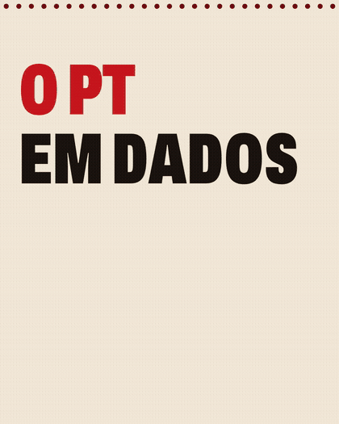
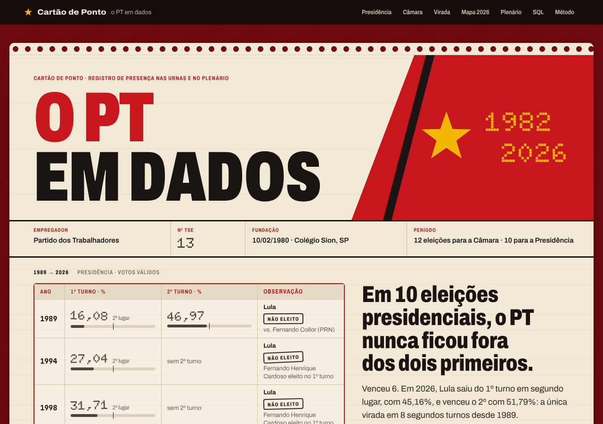
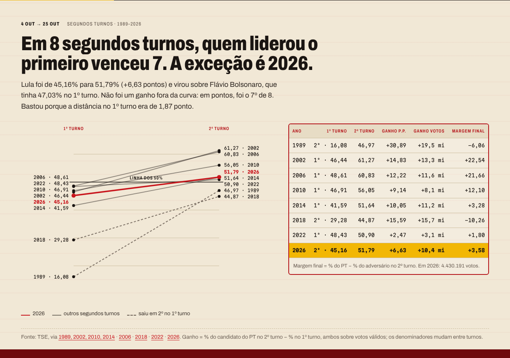
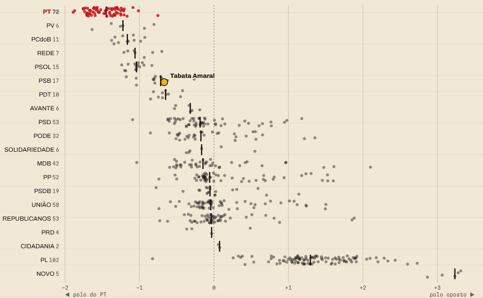
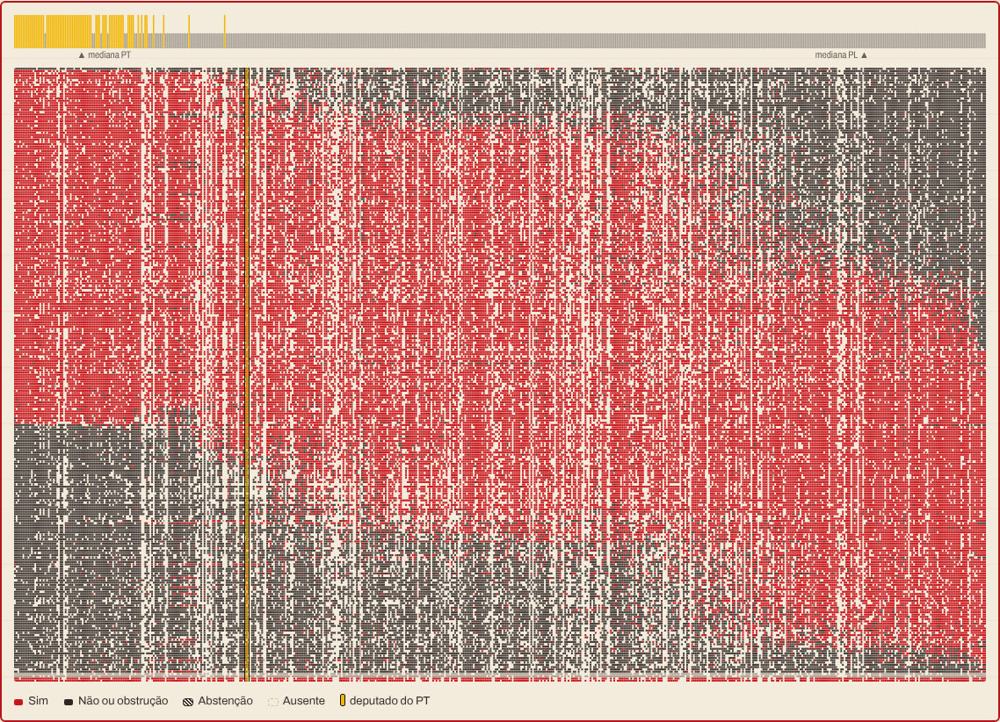
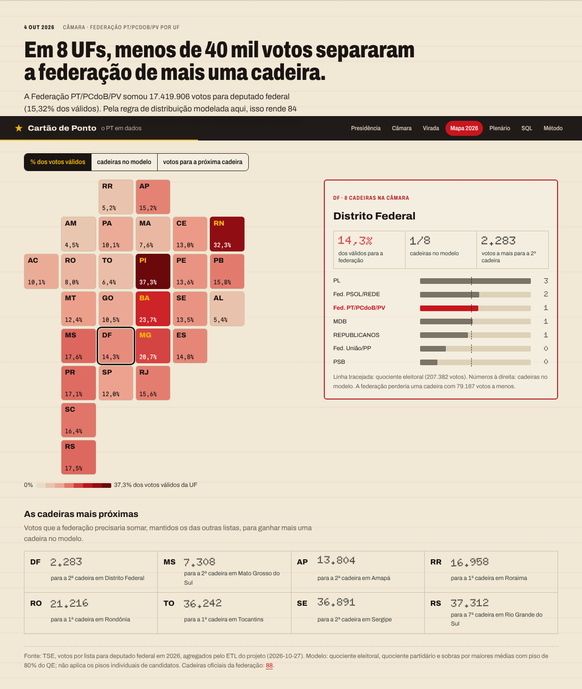
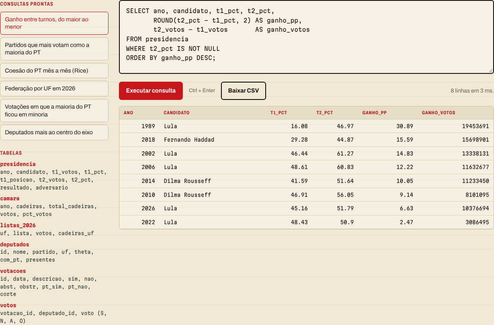
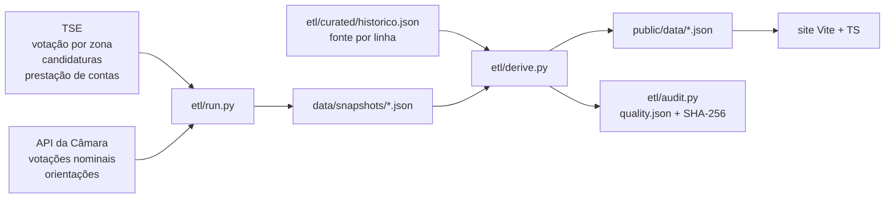
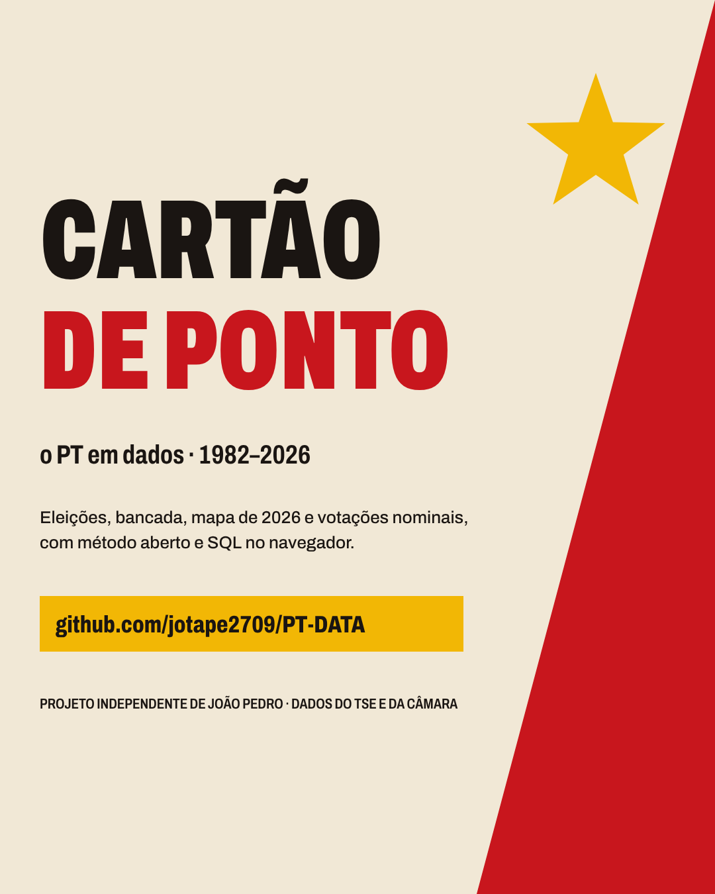

<div align="center">



# Cartão de Ponto · o PT em dados, 1982–2026

**Dez eleições presidenciais, doze para a Câmara, o mapa de 2026 e 269 votações nominais, contados como um cartão de ponto de fábrica.**

Projeto independente de dados de [João Pedro](https://github.com/jotape2709) · TypeScript, Python, SQLite (WebAssembly) e um modelo de pontos ideais

    

</div>

---

## Sumário

- [Por que um cartão de ponto](#por-que-um-cartão-de-ponto)
- [O que os dados mostram](#o-que-os-dados-mostram)
- [O site, seção por seção](#o-site-seção-por-seção)
- [Modelos e métodos](#modelos-e-métodos)
- [Dados, ETL e auditoria](#dados-etl-e-auditoria)
- [Executar](#executar)
- [Animação para redes](#animação-para-redes)
- [Arquitetura](#arquitetura)
- [Limites](#limites)
- [Próximos passos](#próximos-passos)

---

## Por que um cartão de ponto

O Partido dos Trabalhadores nasceu das greves do ABC e foi fundado em 10/02/1980. O objeto mais característico do trabalho de fábrica é o cartão de ponto, onde cada dia vira uma marcação carimbada. Aqui, cada eleição é uma marcação e cada votação nominal é um furo.

- **Carimbo** como assinatura de movimento: números em matriz de pontos ([Doto](https://fonts.google.com/specimen/Doto)) que entram com o tranco de um relógio de ponto.
- **Cartaz** na abertura: a cunha diagonal dos cartazes construtivistas, em vermelho, ouro e preto.
- **Cartão perfurado** no plenário: a matriz real de votos (deputados × votações) desenhada como furos.



## O que os dados mostram

| | Achado | Como foi calculado |
| --- | --- | --- |
| 🗳️ | Em **10 eleições presidenciais** (1989–2026), o candidato do PT terminou o 1º turno **sempre entre os dois primeiros** e venceu **6**. | série curada, fonte por linha |
| ↩️ | Em **8 segundos turnos**, quem liderou o 1º venceu **7**. A exceção é **2026**: 45,16% → 51,79%. | posição no 1º turno × resultado |
| 📏 | A virada de 2026 **não foi um ganho fora da curva**: +6,63 pontos, o 7º de 8. Bastou porque a distância no 1º turno era de 1,87 ponto. | ganho = % 2º turno − % 1º turno |
| 🏛️ | A bancada na Câmara foi de **8 (1982)** a **91 (2002)**, caiu a **56 (2018)** e voltou a **70 (2026)**. | eleitos por pleito |
| 🗺️ | Em **8 UFs**, menos de 40 mil votos separaram a federação PT/PCdoB/PV de mais uma cadeira. No **DF**, faltaram **2.283**. | busca binária no modelo de cadeiras |
| 🧷 | Os deputados do PT seguiram a maioria da bancada em **99,1%** dos votos (Rice 0,98). PV, REDE e PCdoB votaram como a maioria do PT em mais de 97% das vezes; NOVO, em 15,4%. | votações nominais, out/2025–out/2026 |
| 📈 | Um modelo de **um eixo só** reproduz **92,7%** dos votos do plenário, contra 76,8% do palpite “todos votam com a maioria”. | IRT 1D, estimação MAP |

<table>
<tr>
<td width="50%"></td>
<td width="50%"></td>
</tr>
</table>

## O site, seção por seção

| Seção | Pergunta | Visualização |
| --- | --- | --- |
| **Introdução** | (abertura, 4 s, pulável) | o portão da fábrica se abre sobre o cartão: cunha vermelha, engrenagem e estrela, o lema “Trabalhadores de todos os países, uni-vos!” (Manifesto Comunista, 1848) e o carimbo 1980 → 2026; toca uma vez por sessão e é ignorada com `prefers-reduced-motion` (`?nointro` também pula) |
| **Presidência** | Como o PT terminou cada eleição desde 1989? | o próprio cartão: 1º e 2º turno carimbados, linha dos 50% |
| **Câmara** | Quantos deputados o PT elegeu em cada pleito? | gráfico de unidades: um ponto por cadeira |
| **Virada** | O que mudou do 1º para o 2º turno? | slopegraph de 8 segundos turnos e tabela de ganhos |
| **Mapa 2026** | Quanto a federação fez em cada UF e quanto faltou para a próxima cadeira? | cartograma de quadrados com 3 medidas + painel com a conta da UF |
| **Plenário** | Quem vota como o PT? Onde cada deputado fica? | concordância por partido, busca de deputado, cartão perfurado, faixas por partido |
| **SQL** | E se eu quiser perguntar outra coisa? | SQLite no navegador, 6 tabelas, consultas prontas, CSV |
| **Método** | Como cada número foi feito? | linhagem dos dados, fórmulas, limites, relatório de integridade com SHA-256 |



<table>
<tr>
<td width="50%"></td>
<td width="50%"></td>
</tr>
</table>

## Modelos e métodos

**Distribuição de cadeiras** (`src/engine/seats.ts`, espelhado em `etl/seats.py`)

```
QE = válidos / cadeiras          (fração ≤ 0,5 arredonda para baixo)
QP = floor(votos da lista / QE)
sobras: maior média votos / (cadeiras + 1), só listas com ≥ 80% do QE
```

O modelo dá **84** cadeiras para a federação em 2026; o oficial foi **88**. A diferença vem dos pisos individuais de candidatos (10% e 20% do QE), que exigem votos por candidato e não estão modelados. A auditoria registra essa diferença. “Votos para a próxima cadeira” é o menor acréscimo à lista, com as outras fixas, que muda o resultado do modelo. O número de cadeiras é monotônico nos votos da própria lista, então uma busca binária resolve.

**Coesão e concordância** (`src/engine/cohesion.ts`)

```
maioria do grupo = sinal(Sim − Não)        obstrução = Não; abstenção e ausência ficam fora
Rice             = média |Sim − Não| / (Sim + Não)
concordância     = votações com maiorias iguais / votações com as duas maiorias definidas
```

**Pontos ideais, uma dimensão** (`src/engine/irt.ts`, roda em Web Worker)

```
P(Sim_ij) = σ(β_j · θ_i − α_j)        θ ~ N(0,1),  α, β ~ N(0, 25)
```

Estimação MAP por ascensão alternada: um passo de Newton 2×2 por votação e um passo 1D por deputado. θ é re-padronizado a cada iteração; o sinal coloca a mediana do PT à esquerda. Converge em cerca de 12 iterações (~250 ms). O eixo **não tem rótulo ideológico**: é a direção que mais separa os votos no período. O teste com dados simulados exige correlação > 0,95 com as posições verdadeiras.

## Dados, ETL e auditoria



| Base | Conteúdo | Origem |
| --- | --- | --- |
| `historico.json` | presidência 1989–2026 (os dois turnos), Câmara 1982–2026 | curada, URL da fonte em cada linha |
| `listas_2026.json` | votos de cada lista por UF para deputado federal, 2026 | TSE |
| `plenario.json` | 574 deputados × 269 votações nominais (out/2025–out/2026) | API de Dados Abertos da Câmara |
| `quality.json` | 17 verificações + conciliações entre arquivos + SHA-256 | `etl/audit.py` |

A auditoria confere, entre outras coisas: os percentuais do 2º turno batem com os votos dos dois finalistas; o resultado de cada eleição é coerente com o percentual; a soma das listas por UF é igual aos votos válidos de 2026; o modelo de cadeiras fecha o total de cada UF; toda votação tem uma marca por deputado. Ela mede **consistência interna**, não certifica cada registro contra a fonte.

Os snapshots desta versão foram gerados em 27/10/2026 pelo ETL do projeto irmão *Sol Vermelho* (mesmas fontes oficiais, agregação neutra: todas as listas, todas as votações). O `etl/run.py` daqui é a versão do PT e os substitui, incluindo a orientação oficial da bancada em cada votação.

## Executar

Requer Node.js 20.19+ e Python 3.10+. O ETL e a auditoria usam só a biblioteca padrão.

```sh
npm ci
npm run dev              # http://localhost:5173
npm run check            # Vitest + unittest + auditoria + tipos + build
npm run build:single     # dist-single/index.html, um arquivo que abre offline
```

`cartao-de-ponto.html`, na raiz, é esse build de um arquivo: abre com dois cliques, sem servidor.

Atualizar os dados a partir das fontes oficiais:

```sh
python etl/run.py                     # eleições 2006–2026, finanças, Câmara (último ano)
python etl/run.py --so presidencia    # votos do PT para presidente por UF e turno, 1998–2026
python etl/derive.py                  # regenera public/data e o relatório de integridade
```

## Animação para redes

`video/` gera um vídeo de 39,6 s em 1080 × 1350 (4:5) com os mesmos dados do site. A cena é desenhada em canvas como função do tempo (`window.seek(t)`), então cada quadro é exato e reproduzível.

```sh
npx vite --port 5180 &                  # serve video/index.html
node video/render.cjs video/cartao-de-ponto.mp4
```

Pré-visualização em loop: `http://localhost:5180/video/index.html`.



## Arquitetura

```text
src/
  main.ts                 monta as seções, navegação e barra de progresso
  chapters/               uma seção por arquivo (presidência, câmara, virada, mapa, plenário, lab, método)
  engine/                 seats.ts · cohesion.ts · irt.ts (+ worker)
  core/                   motion (carimbo, revelação), tooltip, formatação pt-BR
  styles/main.css         tokens de cor e tipografia no topo
etl/                      run.py · derive.py · audit.py · seats.py · curated/
data/snapshots/           agregados das fontes oficiais
public/data/              bases que o site lê
tests/                    seats · cohesion · irt (Vitest) e etl_test.py (unittest)
video/                    animação em canvas e renderizador
ci/quality.yml            workflow de verificação (mover para .github/workflows/)
```

Acessibilidade: tabelas com papéis ARIA, foco visível, controles por teclado, textos alternativos nos gráficos e `prefers-reduced-motion` respeitado em todas as animações.

## Limites

- Percentuais sobre votos válidos; totais do TSE variam algumas centenas de votos entre divulgação e retotalizações.
- Câmara = eleitos em cada pleito, não a bancada em exercício. Em 2022, a Wikipedia registra 69; parte da imprensa usa 68.
- Partido do deputado = o do primeiro voto na janela; trocas de legenda não são reconstruídas.
- O modelo de cadeiras é simplificado e o IRT descreve o período; nada aqui é previsão ou explicação causal.

## Próximos passos

1. **Deriva**: com `etl/run.py --so presidencia`, calcular o centro de gravidade do voto do PT por UF (média das coordenadas ponderada pelos votos) de 1998 a 2026 e animar o deslocamento.
2. Trocar a maioria da bancada pela **orientação oficial do PT** em cada votação.
3. **Finanças** das candidaturas por fonte de receita (já coletadas pelo ETL).

---

<div align="center">

**Cartão de Ponto** é um projeto independente, sem vínculo com o Partido dos Trabalhadores, a Câmara dos Deputados ou o TSE.<br/>
Feito por **João Pedro** · [github.com/jotape2709](https://github.com/jotape2709)

</div>
